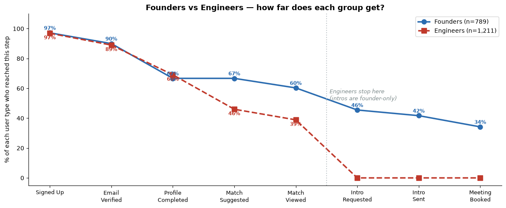
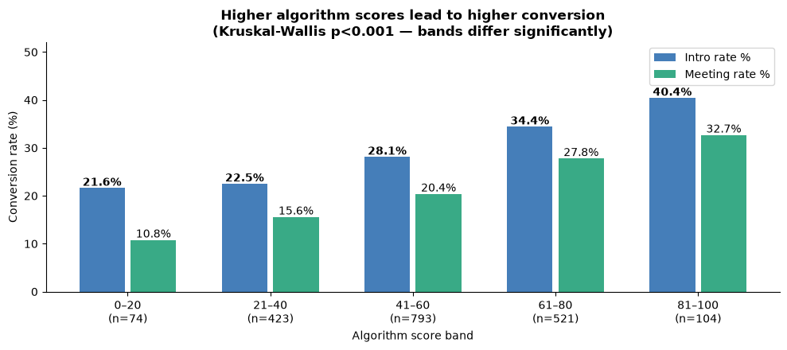
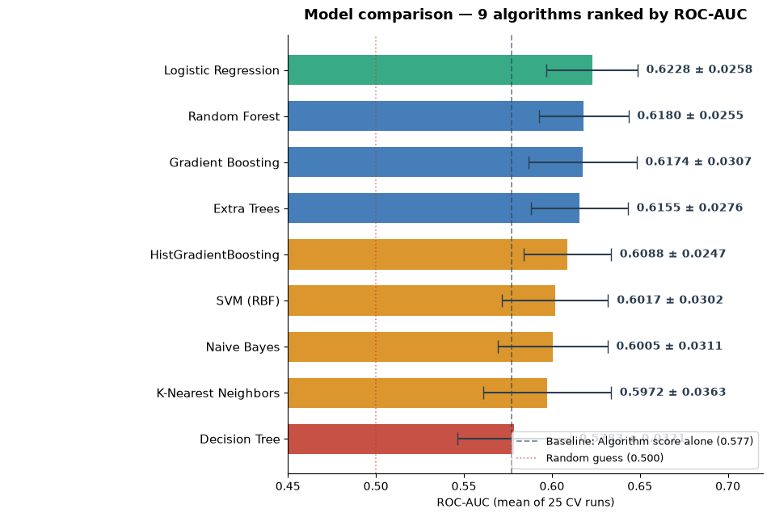

# Foundermatcha: User Journey & Match Conversion Analysis

**MSc Business & Data Analytics (Distinction) research project, Ravensbourne University London**
Research paper co-authored with Sandra Fernando and Farzana Mou, submitted to ICDAM 2026.

Foundermatcha is a platform that matches startup founders with technical co-founders (engineers). It creates plenty of matches, but very few lead to a meeting, and failed matches leave no trace: no error, no complaint. This project finds **where users drop out of the journey** and tests **whether a match's success can be predicted** at the moment it is suggested.

---

## Key findings

**1. The biggest drop-off was a platform rule, not user behaviour.**
The combined funnel showed a **62% drop** between viewing a match and requesting an introduction. Splitting users by role revealed why: only founders are allowed to request introductions, so engineers were being counted as "dropping out" of a step they could never take. For founders alone, the drop is 24.6%.

**2. The real bottlenecks are earlier in the journey.**
- **Profile completion** loses about a quarter of both founders (25.9%) and engineers (22.4%).
- **Match suggestion** loses **33.5% of engineers but 0% of founders**. With 1.54 engineers per founder, the platform runs out of founders to offer, which points to a founder shortage rather than low engineer interest.



**3. The matching score is mostly two yes/no checks.**
Two compatibility flags (compensation and availability) explain **56.2%** of the variation in the platform's 0–100 matching score. Compensation compatibility on its own correlates with introductions at least as strongly as the full score (r = 0.134 vs 0.123), while skills overlap shows no significant link.



**4. Simple beats complex.**
Nine classifiers were compared using 25-round cross-validation. Logistic regression had the best mean ROC-AUC (**0.6228**), but Random Forest and Gradient Boosting were statistically tied with it (paired t-test, p > 0.14), and the stricter corrected test used in the research paper found no model significantly different from it. Since flexible non-linear models found no extra signal, the limit on prediction comes from the data the platform records (for example, user motivation is not captured), not from the choice of algorithm.



---

## Data

| Table | Rows (after cleaning) | Contents |
|---|---|---|
| Users | 2,000 | Role, acquisition source, location, availability, profile completeness, experience |
| Matches | 1,917 | Matching score, skills overlap, compatibility flags, outcome |
| Events | 12,631 | Timestamped journey events (sign-up through to meeting booked) |

Period covered: May 2025 to June 2026.

The [data/](data/) folder contains the three raw tables (`users.csv`, `matches.csv`, `events.csv`, with 2,030 / 1,917 / 14,073 rows) and the cleaned versions produced by notebook 01 (`*_clean.csv`).

---

## Methods

- **Data cleaning (Python, Pandas):** cleaned 14,000+ raw event records, removed duplicates and invalid timestamps, separated structural blanks from genuinely missing values, and imputed 382 missing values with a flag column for each.
- **Funnel analysis:** counted unique users at each of the eight journey stages, pooled and split by role.
- **Statistical testing (SciPy):** chi-square, Mann-Whitney U and Kruskal-Wallis tests (multiple-comparison corrections applied in the research paper).
- **Dashboard (Streamlit, Plotly):** an interactive dashboard that recalculates every figure live from the cleaned data, with filters for user type, location and algorithm score.
- **Score decomposition:** measured how much of the matching score is explained by its compatibility inputs.
- **Predictive modelling (Scikit-learn):** nine classifiers (Logistic Regression, Decision Tree, Random Forest, Extra Trees, Gradient Boosting, HistGradientBoosting, SVM, K-Nearest Neighbours, Naive Bayes) evaluated with repeated stratified 5×5 cross-validation, ROC-AUC, PR-AUC and Brier score.
- **Leakage control:** all preprocessing fitted inside each training fold; a leaking feature (lifetime session count) was found and replaced with sessions recorded before the match.
- **Interpretation:** permutation importance and standardised logistic regression coefficients.

---

## Notebooks

| Notebook | What it does |
|---|---|
| [01_data_cleaning](notebooks/01_data_cleaning.ipynb) | Loads the three raw tables, removes duplicates and invalid events, imputes and flags missing values, validates the cleaned output |
| [02_funnel_analysis](notebooks/02_funnel_analysis.ipynb) | Builds the eight-stage funnel, pooled and by role, plus timing, cohort and device analysis |
| [03_segmentation](notebooks/03_segmentation.ipynb) | Tests which founder and engineer characteristics are linked to conversion |
| [04_algorithm_validation](notebooks/04_algorithm_validation.ipynb) | Checks whether the platform's matching score predicts introductions and what drives it |
| [05_predictive_modelling](notebooks/05_predictive_modelling.ipynb) | Compares nine classifiers with leakage-controlled cross-validation and significance testing |

All charts are saved in [charts/](charts/).

## Interactive dashboard

[dashboard/app.py](dashboard/app.py) is a Streamlit app with five tabs (the funnel leak, speed to first view, who converts, the matching algorithm, and the model). No figure is typed in by hand: every number is recalculated from the data when the app opens, and the sidebar filters recompute all results for any subset of users.

## How to run

```
pip install -r requirements.txt
jupyter notebook                 # run the analysis notebooks
streamlit run dashboard/app.py   # launch the dashboard
```

Run the notebooks in order from the `notebooks/` folder (01 to 05). Notebook 01 rebuilds the cleaned files in `data/` from the raw tables; notebooks 02 to 05 and the dashboard read the cleaned files, so they can also be run on their own. Run the dashboard command from the repository's main folder.

---

## Tools

Python · Pandas · NumPy · SciPy · Scikit-learn · Matplotlib · Plotly · Streamlit · Jupyter

---

## Limitations

The data is observational and from a single platform, so findings are associations rather than proven causes. Median imputation of a bimodal variable (profile completeness) placed 92 users at an unrealistic value. Cross-validation was random rather than time-based, so real-world performance may be lower than reported.

---

## Contact

**Anjali Panchal** · [LinkedIn](https://www.linkedin.com/in/anjali-panchal-6a6323227/) · anjaleepanchal02@gmail.com
